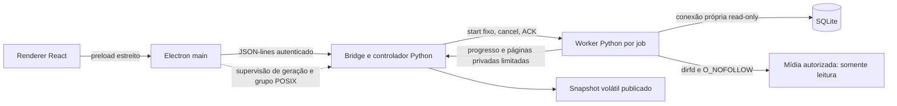
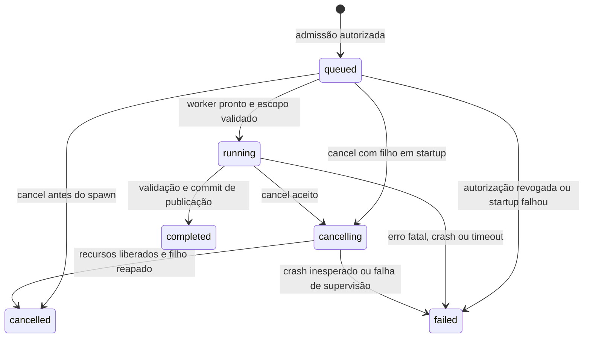

# Desktop MVP D03-02A — Contrato de jobs e lifecycle

Data: 2026-10-29. **Proposta arquitetural para auditoria independente Gemini.**
Não implementa nem autoriza worker, IPC novo, análise real ou D03-02B. A escolha de
processo abaixo é a decisão específica proposta para a necessidade prevista no ADR-004;
só poderá orientar implementação após homologação e autorização posterior do solicitante.

## 1. Base, autoridade e diagnóstico

Inspeção inicial: `main`, HEAD `8f0ded8b66b3fefa67cc99ff55dd1d55a4ab219b`, árvore
limpa inclusive não rastreados, `origin` fetch/push em
`https://github.com/CleberNandi/playmemory-photo-manager.git`. Refs observadas localmente,
sem fetch. Entrega na branch `docs/desktop-mvp-d03-02a`, sem commit, push ou merge.

Foram lidos AGENTS.md, GEMINI.md, ADR-001–004, [D03-00](desktop-mvp-d03-00.md),
[D03-01](desktop-mvp-d03-01.md), [duplicatas](exact-duplicates.md), detector/modelos,
bridge, supervisor Electron, main/preload, projeção desktop e contratos/testes Python e
TypeScript pertinentes ao D03-01. ADRs continuam normativas. Este documento não é um
parecer Gemini nem altera a homologação existente. A orientação Postman api-engineer e
api-documentation foi aplicada à reutilização dos contratos locais; coleção HTTP,
workspace, serviço ou publicação Postman não ajudam a verificar este IPC local e não
foram introduzidos. A skill quality-gates rege os resultados ao final.

Diagnóstico verificável no código atual:

- `desktop/bridge.py:serve` consome JSON-lines sequencialmente. Conexão externa é aberta
  pelo processo Python com URI escapada `mode=ro`, `query_only`, schema versão 2.
  O bootstrap sem catálogo inicializa banco vazio em memória; demo tem catálogo sintético.
- `backend.ts` supervisiona um subprocesso iniciado via `uv run --offline`, autentica
  pedidos com token, correlaciona IDs e filtra geração. Startup: 10 s; pedido: 5 s;
  shutdown: 1,5 s e espera de kill: 2 s. Timeout de pedido remove a promessa e **não**
  interrompe o Python. Grupo POSIX recebe sinais; Windows usa tratamento distinto.
- `find_exact_duplicates(connection)` materializa inventário sob savepoint, observa tamanhos,
  agrupa tamanhos repetidos, lê chunks de 1 MiB, valida evidências, revalida raízes e retorna
  resultado imutável. Não oferece escopo, callbacks ou cancelamento. Guarda inventário,
  candidatos, descritores de raízes, hashes e issues em memória. Não é streaming limitado.
- `eligible_location_count` conta elegibilidade catalogada; `hashed_location_count` é o número
  de membros com hash aceito após validações, inclusive fora de grupos duplicados, e pode
  excluir evidências invalidadas na revalidação de raiz. Não mede tentativas nem bytes lidos.
- D03-01 só apresenta fixture, mantém `analysis_not_available` no modo normal e não carrega
  detector/planner para responder à tela. `generate_exact_duplicate_plan` pode escrever stale:
  **não** é permitido neste fluxo read-only. Não haverá revisão nem plano calculado implicitamente.

Hash no despacho síncrono impediria status, cancel, consultas da UI e shutdown. Aumentar o
request timeout não resolve essa limitação. O shell normal ainda não oferece seleção/autorização
de catálogo real: esta é uma dependência explícita, não uma capacidade presumida.

## 2. Alternativas e recomendação

| Opção | Responsividade e cancelamento | Isolamento, SQLite e custo | Operação, plataforma e distribuição |
| --- | --- | --- | --- |
| A. Thread Python dedicada | Libera despacho se houver loop separado; cancelamento apenas cooperativo; não interrompe `open/read/stat` bloqueante com segurança | Mesmo espaço de memória/falha; conexão própria criada na thread, nunca a da bridge; menor custo | Menos processos; não permite matar só o trabalho; encerrar thread exige matar backend inteiro; não resolve confinamento Windows |
| B. Subprocesso Python por job supervisionado diretamente por Electron | Bridge livre; canal de cancelamento e kill independente | Falha isolada e conexão criada no filho; um processo adicional | Boa alternativa pequena, mas shell passa a coordenar admissão, transferência de escopo e resultados; risco de duplicar regras Python e criar duas autoridades; empacotamento precisa entregar segundo entry point |
| C. Worker Python sob controlador Python | Bridge/controlador responsivo com loop e canais limitados; cancelamento cooperativo seguido de kill do filho | Conexão exclusiva do worker; falha de hash isolada; um processo adicional e cópias transitórias de resultado | Centraliza política em Python; demanda multiplexação, reap e watchdog externo Electron; mesmo runtime empacotado com entry point interno fixo |
| D. Processo persistente/pool | Evita startup por job; interrupção afeta worker inteiro | Mais memória ociosa e estado residual | Pool, recuperação e limpeza sem benefício com concorrência 1; adiar |

**Recomendação: C, um worker descartável por job, sem pool. Alternativa: B**, caso a PoC
mostre que integrar multiplexação ao controlador é desproporcional. B deverá manter autorização,
escopo e projeção em casos de uso Python, sem Electron consultar SQLite ou mídia. A não atende
à necessidade de interrupção isolada; D aumenta complexidade sem demanda demonstrada.

C é composição local do monólito modular, sem daemon, HTTP ou serviço externo. Reutiliza o
backend Python; não introduz dependência do domínio em Electron. Aceita custo de startup e
memória duplicada, a medir com fixtures. Não promete cancelamento imediato nem isolamento de
segurança equivalente a sandbox de SO: o worker continua executando sob o usuário local.

## 3. Processos e responsabilidades propostos



Electron controla bootstrap, geração, sender IPC, watchdog e encerramento externo. Controlador
é a única autoridade de estados, admissão e publicação; worker nunca marca diretamente um job
como completed na API. Worker executa caso de uso, valida evidências e produz staging privado.
Renderer só solicita ação e apresenta estados.

A futura bridge precisa de loop multiplexado: leitor de entrada e leitor do worker alimentam
filas limitadas; uma única thread do controlador despacha transições e escreve stdout. Threads
auxiliares só transportam frames, sem conexão SQLite, domínio ou publicação. Nenhum handler
espera hashing, saída do processo ou resultado integral. A conexão UI continua em sua thread
proprietária. Leitores não podem bloquear indefinidamente o canal de cancelamento atrás de
progresso; controle tem canal independente. Não herdar conexão, token da bridge nem FDs de mídia.
Spawn de entry point fixo por runtime confiável, sem shell, sem executável/argumentos do renderer.

## 4. Máquina de estados e linearização

Estados terminais: `cancelled`, `completed`, `failed`; nunca voltam a estados ativos.
`queued` já reserva o único slot e significa admissão, não fila ilimitada de pedidos.



Timeout sem cancelamento prévio causa `failed(reason=execution_timeout)` e cleanup; permanece
`cleanup_pending=true` até reap. Durante cancelling, timeout do prazo de graça é motivo de
escalada, não sucesso automático. Se a terminação esperada for confirmada, termina cancelled com
`termination=forced`; crash espontâneo demonstrado antes da terminação esperada dá failed.
Sem confirmação de término, falha de supervisão é terminal failed e bloqueia novos jobs.

O controlador serializa cancel e commit de publicação. Se cancel vence, muda para cancelling,
revoga a permissão de publicar e descarta todo staging. Se commit vence, completed com snapshot
já existe e cancel devolve o mesmo estado terminal (`cancel_effect=already_terminal`). Não há
completed após cancel aceito. Cancel repetido em cancelling é idempotente; em cancelled também.
Cancel em failed/completed não altera estado nem descarta snapshot publicado.

`cancelled` só confirma fim da execução e fechamento/reap do filho; aceitar cancel retorna
cancelling, não cancelled prematuro. Falha fatal pode ser conhecida antes da limpeza, portanto
terminalidade lógica e disponibilidade do slot são campos distintos. Toda saída tardia passa
pela verificação de geração, job, attempt e estado; sequência velha não pode publicar nem
incrementar contadores. Reiniciar análise sempre cria novo job/attempt, sem retomar hash parcial.

## 5. Contratos candidatos de IPC

Todos os contratos desta seção são **propostos v1 de jobs**, ainda ausentes. D03-01 v1 permanece
inalterado. Envelope da bridge conserva `id`, `token`, `method`, `params`; o transporte de cada
pedido é curto (limite atual de 5 s), separado da duração do job. IDs de request não são IDs de
job. `session_id` opaco aleatório nasce a cada bootstrap e acompanha respostas e comandos novos;
Electron ainda verifica sua geração local. Job/snapshot/attempt usam UUID aleatório independente,
sem path, hash ou PID como identidade. São referências, não credenciais.

| Método candidato | Parâmetros Python exatos | Resultado de sucesso |
| --- | --- | --- |
| `analysis.start` | `{session_id, authorization_id, client_request_id}` | `{status:"accepted", job: JobStatus}` |
| `analysis.status` | `{session_id, job_id}` | `{status:"ready", job: JobStatus}` |
| `analysis.cancel` | `{session_id, job_id}` | `{status:"ready", job: JobStatus, cancel_effect}` |
| `analysis.result` | `{session_id, job_id}` | completed: `{status:"ready", snapshot: SnapshotDescriptor}`; ativo: `{status:"not_ready"}`; failed/cancelled: `{status:"no_result"}` |

`JobStatus`: version, session_id, job_id, attempt_id, state, revision crescente, scope_id,
created_at/started_at/ended_at UTC ou null, progress, cancel_requested_at ou null,
terminal_reason ou null, termination (`none/cooperative/forced`), cleanup_pending e snapshot_id
somente em completed. `cancel_effect`: `requested/already_requested/already_terminal`.
SnapshotDescriptor contém IDs, source, scope, timestamps, completude, coverage, contadores e
referências de paginação; nunca resultado integral. Erros externos são apenas códigos fixos:
`invalid_request`, `unauthorized`, `stale_session`, `not_found`, `busy`, `temporarily_unavailable`,
`analysis_not_available`, `response_too_large`, `resource_limit`, `internal_error`.
Razões de job incluem `worker_crash`, `startup_timeout`, `execution_timeout`, `protocol_failure`,
`catalog_busy`, `catalog_unavailable`, `resource_limit`, `supervision_failure` e `shutdown`.
Não retornar exceção, SQL, stderr, stack, token, URI, path absoluto nem echo do payload.

Exemplo de corrida: start aceito retorna queued; cancel retorna cancelling; result retorna
not_ready; status posterior retorna cancelled e result retorna no_result. Uma resposta atrasada
completed do worker é ignorada. Já completed com coverage partial retorna ready, com advertência
de cobertura: execução concluída não significa cobertura completa.

### Autorização e escopo

O renderer não envia roots, paths, filtros de filesystem, catálogo, SQL, executável ou método
arbitrário. Uma futura jornada explícita de autorização, fora desta implementação documental,
selecionará apenas LibraryRoot IDs já catalogadas no catálogo ativo e exibirá intenção de leitura,
limitações e escopo. O caso de uso Python valida IDs, associação ao catálogo e políticas; emite
`authorization_id` opaco de sessão, com escopo imutável, validade de 5 minutos para admissão e
uso único, ligado ao sender/janela autorizado. UI não pode emitir esse grant por booleano.
Disponibilidade offline não elimina a raiz do escopo: será issue. Sem grant ou catálogo real
habilitado, start falha fechado (`unauthorized` ou `analysis_not_available`). Nenhum auto-start.

No inventário read-only do worker, conferir de novo IDs e configuração das raízes contra a
configuração autorizada mantida privadamente (inclusive normalized_path). Divergência revoga
admissão, exige nova autorização; não ampliar silenciosamente o escopo. Grant não substitui
confinamento físico. Revogação durante execução solicita cancel. Antes de publicar, controlador
confere novamente a validade da sessão e ausência de revogação; expiração de admissão após start
não revoga por si só o job. Escopo é conjunto exato de raízes e de localizações catalogadas no
snapshot lógico, sem descoberta recursiva de arquivos não catalogados.

### Validação e limites

Preload expõe funções específicas startAnalysis/getAnalysisStatus/cancelAnalysis/getAnalysisResult;
main valida sender/frame da janela e origem confiável, proíbe subframes/navegações inesperadas,
traduz campos camelCase em allowlist. Python revalida tudo e autentica o envelope. Objetos exatos,
sem campos extras/duplicados, arrays indevidos, null implícito, NaN ou coerções. UUID canônico,
strings de IDs no máximo 100 caracteres; client_request_id UUID. Rejeitar chaves JSON duplicadas,
profundidade excessiva e request ID maior que 128 antes de despachar. Não assumir que os handlers
atuais já cumprem todos esses requisitos: testes e endurecimento estarão no incremento de IPC.

Uma execução ativa por sessão/catálogo, nenhum backlog adicional; segundo start distinto é busy.
Retries do mesmo client_request_id e grant retornam o mesmo job, inclusive após timeout de
transporte; chave igual com conteúdo divergente é invalid_request. Cache de deduplicação fica
até reset da sessão; máximo 32 jobs admitidos por sessão, depois resource_limit e novo bootstrap
explícito, sem evicção que permita repetir start acidentalmente. Grant consumido nunca recria job.
Slot só libera após cleanup confirmado; não iniciar outro worker por PID ainda vivo.

Polling é a opção inicial: um pedido de status em voo, intervalo mínimo 500 ms; pausar quando
oculto, consultar imediatamente ao voltar. Sem eventos de progresso no renderer nesta versão.
Limitar no main a 8 pedidos analysis em voo, reservando 1 para cancel, e 4 leituras de páginas;
excesso retorna busy. Worker produz progresso no máximo 4 vezes/s e uma atualização terminal;
controlador coalesce por revisão (não soma deltas). Filas de controle até 16 frames e transporte
de dados até 2 frames de 64 KiB, com ACK por frame. Overflow inválido falha o job, sem crescimento
ilimitado. Cancel não depende de ACK de dados. Usar parser incremental com limite em **bytes**,
sem acumular stdout ilimitado e sem confundir várias linhas válidas com frame excessivo.

Preservar entrada de 64 KiB, páginas de 240 KiB ASCII compacto e envelope de 256 KiB incluindo
newline; status até 8 KiB. Bytes/tamanhos em decimal textual; números contadores/revisões só
inteiros seguros JavaScript; overflow falha explicitamente. Frame inválido é protocol_failure,
sem publicar material parcialmente validado. stderr é drenado com orçamento de 4 KiB e códigos
sanitizados; não concatenar mensagens privadas em diagnósticos públicos.

## 6. Contratos Python e propriedade SQLite

Interfaces candidatas, não assinaturas já entregues:

```text
AnalysisController.start(session, grant, client_request_id) -> JobStatus
AnalysisController.status(job_id) -> JobStatus
AnalysisController.cancel(job_id) -> JobStatus
AnalysisController.result(job_id) -> SnapshotDescriptor | NotReady | NoResult
analyze_exact_duplicates(catalog_inventory, *, progress_sink, cancellation) -> ExactDuplicateResult
Cancellation.checkpoint() -> None | raises AnalysisCancelled
ProgressSink.publish(ProgressSnapshot) -> None
```

Caso de uso de seleção materializa inventário autorizado em transação read-only; detector futuro
consome esse inventário imutável. Preservar `find_exact_duplicates(connection)` para consumidores
atuais por adapter compatível. Checkpoints não retornam ExactDuplicateResult em cancelamento.
ProgressSink recebe apenas IDs internos/contadores, nunca descritores; exceções de infraestrutura
não viram issue de arquivo silenciosamente. `AnalysisCancelled` deve atravessar os blocos que
tratam OSError/ValueError; usar exceção própria derivada de Exception com unwind por finally.
Não serializar dataclasses internas diretamente à UI.

| Dono | Conexão e uso | Encerramento |
| --- | --- | --- |
| Bridge/controlador, thread de despacho | Conexão UI já existente; externa mode=ro/query_only; não migrar nem convertê-la em global gravável | finally do bootstrap, após parar admissão |
| Worker, thread principal própria | Abre URI mode=ro escapada, query_only, row_factory local; valida user_version=2 e suporte STRICT do runtime; sem initialize_database/migrations | Fecha transação após inventário; fecha conexão antes de hashing; finally para falha/cancel |
| Threads de transporte e Electron | Nenhuma conexão; nenhum acesso SQL ou ao filesystem de mídia | Fecham somente canais próprios |

Não usar fork com conexão herdada, check_same_thread=False ou immutable=1 para catálogo que
pode mudar. Demo em memória não é catálogo real compartilhável com filho: permanece fixture;
testes de worker usarão SQLite temporário em disco. Não copiar catálogo pessoal para contornar isso.

Uma transação curta explícita de leitura fixa Assets, FileLocations, raízes e nomes necessários
no mesmo snapshot lógico, incluindo localizações inelegíveis do escopo. Inventário limitado é
materializado antes de liberar transação; não segurar snapshot SQLite durante hashing. Registra
catalog_observed_at e scope_id; não inventar número de revisão do banco inexistente. Mudança do
catálogo após essa captura não atualiza inventário nem snapshot publicado; detalhes da UI podem
mostrar estado posterior e isso deve ser identificado. Não é snapshot atômico do filesystem.

Leituras UI usam conexão independente. Não mudar journal_mode para WAL nem assumir WAL já ativo;
transação curta pode atrasar escritor em rollback journal. busy_timeout do worker: 250 ms;
até 3 tentativas de inventário completo em no máximo 2 s, com esperas canceláveis e sem mídia
aberta. LOCKED não recuperável na conexão própria encerra como catalog_busy; não repetir loop
infinito. Nenhuma tentativa repetida após começar hashing: nova execução exige novo job.
Runtime sem suporte ao schema STRICT (SQLite 3.37+) ou versão incompatível falha antes de ler
mídia, sem migration. Nenhuma mudança de schema/PRAGMA persistente pertence à análise.

## 7. Progresso verificável e cancelamento

Fases em ordem: `inventory`, `size_inspection`, `pregrouping`, `hashing`, `final_validation`,
`publication`. Fase só avança; contadores são acumulados monotonicamente, não zerados entre fases.
Timestamp de progresso é observação operacional, não data de captura da mídia.

| Campo | Regra e denominador |
| --- | --- |
| considered_locations | Linhas inventariadas no escopo; total null até fim do inventário |
| eligible_locations | file/present em raiz available segundo catálogo; equivalente ao contador existente |
| ineligible_locations | Consideradas que não satisfazem elegibilidade; não confundir com falha física |
| size_inspected / size_candidates | Tentativas encerradas de observação / observações válidas para pré-grupo |
| hash_planned_locations / hash_planned_bytes | Fixados depois do pré-agrupamento por tamanho observado; antes, null |
| hash_started_locations / hash_finished_locations | Primeira tentativa de hash / tentativa encerrada por sucesso ou falha; cancel interrompido não conta finished |
| bytes_read | Soma real de len(chunk) retornado por read, inclusive arquivo depois invalidado; zero em arquivos vazios |
| read_failures / issue_count | Falhas de leitura e issues únicas, separados de exclusões e file_changed |
| verified_hash_locations | Só fixado ao concluir validação final; antes null; corresponde ao hashed_location_count final |
| validated_roots / total_roots | Trabalho de revalidação final; total conhecido após inventário |

Cada localização tem no máximo uma tentativa por job; hardlinks são ocorrências separadas e os
bytes de cada leitura contam. Não estimar bytes lendo stat, nem contabilizar cache como ausência
de leitura. bytes_read pode superar hash_planned_bytes se arquivo cresce antes de rejeição;
mostrar bytes reais, sem reduzir contador ou porcentagem falsa. Total fixado não é garantia de
trabalho concluído com sucesso. Percentual global não será exibido; UI mostra fase, contagens e
bytes. Onde denominador é null, mostrar indeterminado. Estado completed vem apenas do commit.

Detector precisa futuramente expor checkpoints: antes/depois do inventário, entre raízes,
entre candidatos e inspeções, antes de cada open, antes/depois de cada read de até 1 MiB,
antes de aceitar digest, entre revalidações e antes de retornar. Pré-grupo e ordenação grandes
precisam de limites e checkpoints nas etapas iterativas; uma chamada sort não se torna
interrompível por callback. Callback nunca substitui verificações de segurança.

Manter O_NOFOLLOW, abertura componente a componente com dirfd, arquivo regular, comparação de
device/inode/tamanho/mtime/ctime/nlink, comparação com observações catalogadas/hash verified e
revalidação de paths e raízes. Não publicar digest antes dessas verificações. Cancelamento
fecha file_fd, parent_fd, root_fd e conexão por context managers/finally no processo dono.
Controlador não fecha descritor do worker por número recebido nem reabre paths para “limpar”.
Leitura pode atualizar atime; read-only não promete ausência de efeitos do driver/filesystem.

O_NOFOLLOW e O_NONBLOCK não impõem deadline a leitura de arquivo regular em disco/NFS.
Thread de controle do worker só seta flag e mantém canal/heartbeat; não fecha SQLite ou FDs da
thread de análise. Bloqueio de kernel pode impedir checkpoint e até atrasar efetivação de SIGKILL.
Resultado interrompido nunca é promovido a “completo”. Falhas observadas e motivo de término
ficam no resumo limitado do job; grupos provisórios não são expostos.

## 8. Snapshots e paginação

Snapshot é volátil, imutável e vinculado a session_id/job_id/snapshot_id distintos. Origem real
proposta: `source="catalog_exact_detector"`, `freshness="snapshot"`,
`location_source="catalog_observation"`. `observation_started_at`/`observed_at` delimitam leitura
física e conclusão de validação em UTC; `published_at` é outro instante, não evidência física.
Sem observação física (por exemplo confinamento indisponível), ambos os timestamps de observação
física são null; published_at continua definido. Guardar catalog_observed_at, scope_id e
LibraryRoot IDs autorizadas, versão de detector/protocolo,
coverage e totais globais. Timestamp único não afirma simultaneidade das leituras.

`execution_completeness="finished"` é obrigatório para publicação e independente de
`coverage=complete/partial/unavailable`. Issues preservam enums e IDs do detector. Complete vazio
significa nenhum grupo encontrado nas localizações catalogadas do escopo naquele intervalo;
partial/unavailable vazio não prova ausência. Unavailable pode concluir sem hashing, com causa
explícita; não é erro de transporte. UUID de Asset continua identidade lógica; mesmo SHA-256 não
funde ocorrências. Contagem física distingue hardlinks, nunca estima espaço liberável.

O worker envia manifesto e registros privados com limites/ACK, incluindo contagem e digest da
transferência canônica. O controlador valida tipos, IDs pertencentes ao inventário autorizado,
ordem, unicidade, contagens, budgets e finalização da transferência. Não precisa receber um
objeto JSON gigante. Digest é integridade de transporte local, não autorização nem novo hash de
mídia. Não recalcular fingerprint por página: evidência não calculada continua null. Proteção,
review e plan_state desconhecidos ficam null; não chamar planner para preenchê-los.

Commit atômico em memória ocorre somente após EOF de resultado válido, saída normal/reap do
worker, fechamento de recursos, sessão/grant válidos e ausência de cancel aceito. Troca ponteiro
do snapshot ativo e estado completed no mesmo passo serializado. Antes disso nada é consultável
como resultado, nem páginas parciais. Progresso é a única consulta parcial permitida. Resultado
partial por issues é produto final da execução, não staging de job incompleto.

Durante novo job manter snapshot anterior disponível, explicitamente identificado como anterior;
falha/cancel preserva-o. Só commit bem-sucedido substitui e invalida o anterior; leitura já em voo
carrega snapshot_id e renderer ignora geração/ID antigo após troca. Cursores antigos passam a
stale_snapshot, nunca são reinterpretados. Restart de backend invalida todos os jobs/snapshots;
main emite reset e UI descarta seleção/páginas como no D03-01. Não há retomada automática,
importação/exportação operacional, persistência em SQLite ou staging em disco.

### Compatibilidade e limites de retenção

Não alterar as páginas v1 sintéticas nem seus cursores. Propor projeção real **v2**, negociada
explicitamente por adaptador novo; antes disso modo normal continua analysis_not_available.
Candidatos `analysis.groups`, `analysis.members`, `analysis.issues` recebem session_id,
snapshot_id, page_size opcional (1..50, default 24), after opcional; members exige group_key.
Result retorna só manifesto. Isso evita fazer duplicates.list trocar silenciosamente de contrato.
Issues v2 têm issue_count global e página dedicada, sem lista integral em toda página. Resumos e
membros preservam as semânticas D03-01, byte_size decimal, IDs, relativos como texto e ausência
de path absoluto/device/inode/URLs. Novas origens/completude são discriminadas pela versão.

Cursor v2 canônico base64url, até 2048 caracteres, campos exatos version/session/snapshot/kind/
order/group/offset; kind distingue grupos/membros/issues, group null salvo em membros. Grupos:
SHA-256 e tamanho numérico; membros: nome da raiz/relativo/location_id; issues: root_id/relativo/
location_id/kind. Nome da raiz vem do inventário congelado. Offset estrito inteiro seguro, sem
bool, positivo e dentro da coleção; primeira página usa null. Cursor cruzado/malformado é
invalid_request; snapshot substituído/reset é stale_snapshot. Cursor não é autorização. IDs e
strings não são truncados para caber numa página; retornar response_too_large e preservar snapshot.

Budgets iniciais propostos, a validar com fixtures antes da integração real: até 64 raízes,
50.000 localizações no inventário, 50.000 issues únicas, 32 MiB de inventário canônico e 32 MiB de
snapshot canônico completo. Toda contagem inclui o escopo inteiro, sem cortar cauda. Ao exceder:
failed/resource_limit, nenhum snapshot novo. Até 64 descritores de raiz mantidos; descritores
transitórios de travessia devem ser fechados a cada componente como hoje. Read buffer: 1 MiB.
Retenção: um snapshot publicado e um staging, até reset; 32 resumos de jobs e respectivas chaves
de deduplicação, sem conservar resultados substituídos. Sem TTL oculto de snapshot ativo.

Limite serializado não é limite de heap: PoC deve medir RSS e contabilizar estruturas acumuladas
antes de duplicá-las; teto inicial por worker 256 MiB e overhead incremental do controlador
256 MiB (inclui snapshot anterior, staging e projeções). Watchdog amostra RSS a cada 500 ms;
exceder falha o job e inicia cleanup. Há overshoot possível entre amostras; proteção rígida de SO
é decisão de empacotamento, não garantia atual. Sem monitor confiável, não habilitar análise real
nesse alvo. Não usar esses números como benchmark de acervo suportado. Eliminar cópias
integrais/deepcopy por página e liberar buffers após ACK; testar pico de memória é bloqueante.

## 9. Timeout, shutdown, restart e órfãos

Valores propostos para PoC, diferentes dos timers existentes da bridge:

| Situação | Política |
| --- | --- |
| Startup do worker | 10 s até ready privado; falha startup_timeout e cleanup |
| Duração do job | 30 min monotônicos do admission ao commit; failed/execution_timeout ao vencer; sem auto-retry |
| Heartbeat privado | 1/s; 10 s sem heartbeat inicia falha e terminação; heartbeat não prova avanço de I/O |
| Nenhum avanço de trabalho | 120 s sem fase/contador/bytes avançar, inclusive com heartbeat: execution_timeout; pode rejeitar mídia legitimamente lenta, limitação explícita |
| Cancel aceito | Flag cooperativa e 2 s de graça; SIGTERM; após mais 2 s SIGKILL; esperar reap por até 2 s |
| Quit/restart normal | Fechar admissão, cancelar job, drenar controle e aguardar orçamento total de 6 s do worker; depois encerrar bridge |
| Crash worker | failed/worker_crash, staging descartado; reap antes de liberar slot; bridge/UI continuam consultáveis |
| Crash bridge | Electron invalida geração, termina grupo de processos e confirma saída; novo bootstrap somente após cleanup ou bloqueio explícito |

Não reutilizar o shutdown de 1,5 s como prazo total de análise: incremento de lifecycle precisará
coordenar o orçamento externo Electron com os 6 s internos e prazo adicional de encerramento da
bridge, sem matar controlador antes da tentativa cooperativa. Timer de request curto não é
watchdog do job. Monotonic clock define deadlines; UTC serve apenas para apresentação.

Worker não cria descendentes nem grupo destacado próprio: permanece no grupo POSIX supervisionado
pelo Electron. Controlador reap seu filho, fecha pipes e em EOF do canal de controle worker
solicita saída. Python controlador detecta EOF do Electron, cessa admissão e limpa filho. Electron
mantém handle/grupo até confirmação; não confundir limpeza de referências JS com processo morto.
Se SIGKILL não produzir saída em 2 s, failed/supervision_failure, cleanup_pending=true, slot e
restart bloqueados, UI informa encerramento pendente. Não reaproveitar PID sem validar handle.

Em morte abrupta do Electron/SO, EOF e guarda de parent no worker são mitigação, não garantia
universal de ausência imediata de órfãos, especialmente em I/O ininterruptível. PoC POSIX deverá
validar parent-death guard/watchdog no bootstrap e testes de morte abrupta; se não demonstrar
cleanup, não homologar esse lifecycle. Não publicar resultado após perda do controlador.
Reabrir aplicação não recupera jobs/snapshots voláteis nem inicia nova leitura sem nova intenção.
Não varrer/matar PIDs genéricos de Python na inicialização.

## 10. Segurança e plataforma

Linux/POSIX é primeiro alvo de prova, não homologação multiplataforma. macOS exige testes reais
de dirfd/O_NOFOLLOW, sinais, processo empacotado e lifecycle. Windows permanece fail-closed
coverage unavailable para confinamento físico sem adapter equivalente auditado; não trocar por
resolve/check-prefix, nem seguir junction/reparse point. Controle de árvore Windows exigirá
supervisão própria (por exemplo Job Object) testada antes de análise real, sem presumir equivalência
de SIGTERM/SIGKILL. A UI sintética pode continuar funcionando independentemente dessa capacidade.

Empacotamento futuro deve selecionar runtime Python e entry point internos fixos, versão SQLite
compatível, ambiente reduzido e canais privados sem listener de rede. O comando uv de desenvolvimento
não é contrato final de distribuição. Nenhuma recomendação homologa Electron além do ADR-004.

Root path autorizado pode ainda sofrer substituição física: só a cadeia segura de descritores e
revalidações demonstra confinamento. Não transformar leitura em gravação de hash/sidecar, merge,
missing/offline atualizado ou decisão de revisão. Relativos e nomes exibidos também são dados
privados: renderizar como texto, sem HTML, links file ou logs automáticos. Logs operacionais só
códigos/IDs opacos, limites e tempos, sem conteúdo de paths ou hashing. Testes de sanitização
incluem Unicode, controles, Windows paths, tokens e exceções inventadas.

## 11. Matriz de testes projetada

Nenhum teste abaixo é apresentado como implementado neste checkpoint. Usar relógio fake,
barreiras explícitas, pipes controlados e fixtures temporárias; evitar sleeps como sincronização.

| Risco/contrato | Experimento determinístico e oráculo |
| --- | --- |
| Transições | Tabela de todas as arestas permitidas e proibidas; terminal não muda; revision cresce |
| Exclusividade/idempotência | Starts concorrentes, retry após resposta perdida e grant consumido; um spawn, segundo distinto busy |
| Progresso | Read fake com chunks conhecidos, zero bytes, hardlinks, falha após N bytes e arquivo invalidado; bytes exatos e contadores monotônicos, totais null até fixação |
| Cancel queued/startup | Barreira antes de spawn e antes de ready; nenhum hash; reap se filho já criado |
| Cancel no hashing | Barreira entre chunks/candidatos e antes do commit; finalmente fecha FDs; no_result e zero publicação |
| Corrida cancel/commit | Duas ordens controladas; só uma vence; late result/ACK/heartbeat não revive job |
| Crash/timeout | Filho temporário sai com erro, trava controladamente ou envia frame inválido; motivo correto, staging descartado, deadline fake |
| Shutdown/restart | Quit em cada fase e EOF do pai; reaping, FDs/pipes fechados, nenhum filho vivo após prazo normal; geração antiga rejeitada |
| Encerramento difícil | Simular kill sem exit: cleanup_pending e admissão bloqueada; teste POSIX de grupo/parent-death em processo sacrificial |
| SQLite | Fixture de disco STRICT v2, trace sem escrita/migration, conexão criada/usada/fechada no worker; UI paralela; writer segura lock para exercitar retries limitados |
| Escopo | Grant com roots catalogadas; ID estrangeiro, mudança de root path, revogação e expiração; zero leitura fora do conjunto |
| Coverage | Offline, missing, symlink, mudança e read_failed; completed partial separado de cancelled; unavailable não vira empty complete |
| Snapshot | Transferência interrompida/digest inválido, limite excedido e cancel antes do commit não substituem anterior; paginação cobre IDs sem repetição |
| Payload/backpressure | Campos extras/duplicados, bool em inteiro, UTF-8 dividido, profundidade, frame excessivo e várias linhas; controle ainda atende cancel |
| Privacidade | Exceções com paths/tokens/SQL e nomes com markup; apenas códigos públicos, texto literal, nenhum original ou sidecar escrito |
| Confinamento POSIX | Reexecutar suíte existente; symlink em raiz/ancestral/final, traversal, inode/mtime/ctime/nlink alterados e revalidação de raiz, com cancel em cada barreira |
| Recursos | Limites de raízes/linhas/issues/bytes/RSS, consumidor lento e snapshot anterior retido; memória limitada, sem resultado truncado |
| Compatibilidade D03-01 | Fixture v1, cursors, 105 membros, inteiros grandes, galeria e reset inalterados; v2 real nunca se apresenta como synthetic |

Ausência de órfãos exige testes com processos reais além de mocks de signal: monitor externo ao
grupo de teste observa exit/waitpid e canais. Caso de I/O kernel ininterruptível só pode ter
simulação de política e limitação registrada; não prometer prazo físico garantido. Nenhuma foto
pessoal é necessária. Testes de detector usam exclusivamente mídia sintética temporária.

## 12. Riscos e decisões pendentes

- Aprovação Gemini e autorização do solicitante para C e qualquer implementação são pendentes.
  Esta proposta não altera ADR aceita por inferência.
- Jornada de catálogo/LibraryRoot/grant ainda precisa de contrato revisável; sem ela, start real
  continua indisponível. Não oferecer root picker arbitrário pelo novo IPC.
- Multiplexação da bridge, transferência limitada, watchdog e guard de parent são trabalho novo,
  com risco de regressão de galeria e shutdown; alternativa B continua opção sujeita a nova decisão.
- Budgets, RSS, timers e responsividade devem ser medidos com dados sintéticos. Filesystems lentos
  podem atingir timeout legitimamente; sem retry automático e sem conclusão negativa de duplicidade.
- Resultado é evidência pontual, não snapshot transacional do acervo. Consumo posterior não autoriza
  operação física; revisão/plano/revalidação possuem contratos independentes.
- Persistência de snapshots, retomada, múltiplos jobs/pool, eventos push e suporte físico Windows
  exigem decisões específicas posteriores. Nada disso é pré-requisito para fixture D03-01.

## 13. Plano incremental após autorização

1. **D03-02B: núcleo de lifecycle e instrumentação**, com fake worker e dados temporários:
   máquina de estados, cancel checkpoints/progresso, adapter compatível do detector e testes de
   confinamento. Sem habilitar análise real no desktop por mera existência do núcleo.
2. **D03-02C: supervisão e SQLite**, spawn fixo, conexão read-only própria, inventário de escopo,
   pipes limitados, timeout/reap/parent guard e pico de memória; PoC exclusivamente sintética.
3. **D03-02D: contratos de autorização e IPC**, catálogo/roots previamente autorizados, grants,
   idempotência, sender validation, polling e controle de concorrência; auditoria antes de habilitar.
4. **D03-02E: publicação e UI**, projeção v2, paginação de issues, substituição atômica e reset;
   galeria e fixture v1 preservadas. Smokes Electron/Python com raízes temporárias.
5. Só após evidências e autorização específica, habilitar análise de catálogo real escolhido pelo
   usuário. Homologação de empacotamento/plataformas é checkpoint separado.

Cada incremento requer escopo próprio, contratos primeiro, testes e auditoria; a enumeração não
constitui autorização nem compromisso de nomes finais dos checkpoints posteriores.

## 14. Critérios objetivos de aceite

Para D03-02A: somente este documento novo; baseline conferido; contratos atuais distinguidos de
propostas; comparação das alternativas, estados/corridas, autorização, SQLite, progresso,
cancelamento, limites, snapshots, testes e pendências explícitos; gates documentais executados;
nenhum hashing operacional, implementação ou alteração de schema/Lab; auditoria Gemini pendente.

Para futura execução real: todos os testes da matriz pertinentes aprovados; nenhuma publicação
após cancel; slot não liberado antes de cleanup; consultas/status/cancel não aguardam hashing;
PoC sintética com polling atendido dentro de 500 ms em ambiente registrado e cancel cooperativo
observado no próximo checkpoint; escalada e parent-death demonstradas; memória e frames dentro
dos budgets; nenhum acesso fora do escopo; nenhuma escrita SQL/mídia; ausência de órfãos em
shutdown/crash controlados; nenhuma regressão D03-01; autorização explícita posterior à auditoria.
Prazo de I/O bloqueante não é garantido: falha segura e ausência de publicação são obrigatórias.

## 15. Verificações deste checkpoint

Gates de Python usam
apenas fixtures sintéticas da suíte; não foi chamada análise de catálogo pessoal. Testes de
lifecycle acima são plano, não capacidade comprovada por esses gates existentes. Build/smokes
Electron não são pertinentes a diff exclusivamente Markdown, sem alteração de contrato efetivo.


| Gate executado nesta entrega | Resultado |
| --- | --- |
| `UV_CACHE_DIR=/tmp/playmemories-d03-02a-uv-cache uv sync --locked` | PASS; lockfile intacto |
| `UV_CACHE_DIR=/tmp/playmemories-d03-02a-uv-cache uv run pytest` | PASS; 317 testes, 9,99 s |
| `UV_CACHE_DIR=/tmp/playmemories-d03-02a-uv-cache uv run ruff check .` | PASS |
| `UV_CACHE_DIR=/tmp/playmemories-d03-02a-uv-cache uv run ruff format --check .` | PASS; 96 arquivos |
| `git diff --check` | PASS |
| `git diff --no-index --check /dev/null -- docs/desktop-mvp-d03-02a.md` | PASS; sem mensagens de whitespace |
| Inspeção final de status, diff e arquivos não rastreados | Só este Markdown novo; nenhum código, schema, lockfile, banco, mídia ou artefato alterado |
| Build/testes JS e smokes Electron | NOT RUN; nenhuma mudança funcional ou de UI |

Resultado dos gates aplicáveis: **PASS**. O cache temporário foi selecionado preventivamente,
sem mudar configuração. A criação da branch exigiu execução fora da restrição read-only de
`.git`, concluída na branch proposta; a primeira tentativa não criou a ref. Nenhum commit,
push, merge, fetch ou acesso ao Duplicate Lab foi realizado. A suíte usa hashing apenas em
arquivos sintéticos temporários dos testes existentes, sem análise operacional de acervo.
A auditoria independente Gemini deste documento ainda está pendente; PASS dos gates não
homologa a arquitetura proposta nem autoriza D03-02B.


## 16. Homologação documental e prioridade posterior

Em 2026-10-29, conforme parecer informado pelo solicitante, a auditoria independente
Gemini aprovou D03-02A com **PASS**, sem BLOCKER, MAJOR ou MINOR. Este registro
atualiza as referências históricas a auditoria pendente nas seções anteriores;
o conteúdo auditado foi preservado integralmente. A aprovação é documental e não
constitui autorização para implementação funcional ou alteração de ADR aceita.

As três observações da auditoria ficam registradas para futuros incrementos autorizados:

- **Orçamento de shutdown do Electron:** compatibilizar o prazo global do supervisor
  Electron com cancelamento cooperativo, escalada, fechamento de canais e reap do worker;
  validar esse orçamento na PoC antes de habilitar execução real.
- **Generalização de jobs:** avaliar discriminação explícita por `job_kind` ou progresso
  tipado para acomodar outros trabalhos sem tornar o contrato de lifecycle dependente
  exclusivamente da análise de duplicatas.
- **Spawn e isolamento de recursos:** tornar explícito o mecanismo de spawn e a
  sanitização do ambiente e dos descritores herdados, preservando runtime e entry point
  confiáveis e impedindo herança indevida de conexões, tokens e descritores.

O desenvolvimento funcional de **D03-02B está adiado em favor da prioridade D04 —
Biblioteca Real**. O plano da seção 13 permanece referência arquitetural futura, sem
constituir a ordem atual de execução. Esta consolidação não inicia D03-02B nem D04.
A publicação ocorre em PR exclusivamente documental; merge e integração dependem de
nova autorização específica do solicitante, sem auto-merge.
