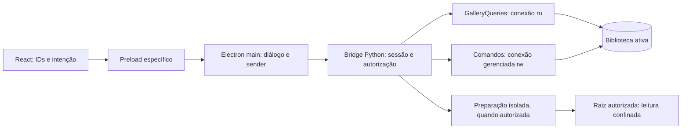

# Desktop MVP D04-00 — Checkpoint arquitetural da biblioteca real

Data: 2026-10-29. Status: **proposta documental para auditoria independente Gemini e aprovação posterior**.
Não inicia D04-01 nem autoriza implementação, migrations, ingestão, workers ou acesso a fotografias
pessoais. D03-02A foi homologado e integrado conforme informação do solicitante; seu texto é um
contrato arquitetural, não infraestrutura de jobs implementada. D03-02B continua adiado.

## 1. Base inspecionada e autoridade

Baseline local confirmada: branch `main`, HEAD `9dc41e6ec6c4bab33ca8d0b057f560b9ea9f166e`,
working tree limpa, inclusive não rastreados. Remoto existente `origin`, fetch/push:
`https://github.com/CleberNandi/playmemory-photo-manager.git`. Não houve fetch; isto registra
refs locais, não sincronização remota. Entrega na branch `docs/desktop-mvp-d04-00`, sem commit,
push ou merge. Nenhum laboratório ou VM foi acessado.

Leitura: AGENTS.md, GEMINI.md, ADR-001–004, [persistência](persistence.md),
[aplicação](catalog-application.md), [scanner](readonly-scanner.md),
[evidências](evidence-evaluation.md), [planner](catalog-change-planning.md),
[ingestão](catalog-ingestion.md), [galeria](gallery-read-model.md),
[D03-02A](desktop-mvp-d03-02a.md), [jornadas](mvp-user-journeys.md),
[convergência](product-architecture-convergence.md) e [D02C](desktop-mvp-d02c.md).
Foram inspecionados os módulos Python correspondentes em `catalog`, `scanner`, `evidence`,
`change_planning`, `catalog_ingestion`, `gallery`, `desktop/bridge.py`, e main, preload,
supervisor, tipos e App React em `desktop/src/`. As ADRs permanecem normativas; este checkpoint
não homologa definitivamente Electron ou suporte multiplataforma.

Aplicada a skill Postman api-documentation à descrição dos contratos locais e efeitos.
A fonte de verdade continua no repositório; não há contrato HTTP, workspace ou publicação
Postman a criar. A skill quality-gates orienta a validação, limitada a documentação por
instrução expressa desta tarefa. As decisões abaixo são propostas, salvo fatos explicitamente
identificados como implementados.

## 2. Estado atual e matriz de capacidades

| Capacidade | Implementação observada | Lacuna para biblioteca real |
| --- | --- | --- |
| SQLite persistente | `catalog/database.py`: conexão gerenciada, UDFs, FKs, STRICT, migrations 001/002 | Lifecycle desktop, criação exclusiva, abertura sem migração e diagnóstico |
| Casos de uso | `Catalog`: raízes, Assets, localizações, organização e transações | Sessão de biblioteca e autoridade de comandos no desktop |
| Scanner | POSIX por descritores, sem seguir links; cancelamento cooperativo | Execução responsiva, budgets durante enumeração, projeção paginada |
| Evidências/plano | Funções puras, conservadoras e tipadas | Integração de seleção nativa, elegibilidade e revisão na UI |
| Catalogação | `prepare_ingestion`, `authorize_ingestion`, `apply_ingestion` | Adapter desktop confiável; classificação e frescor físico |
| Galeria/detalhes | `GalleryQueries.list_assets/get_asset_details`, keyset, DTOs read-only | Vincular biblioteca ativa, reset completo e refresh após commit |
| Bridge | JSON-lines autenticado; externa `mode=ro`, `query_only`, verifica `user_version=2` | Validação completa de schema, comandos separados e seleção de catálogo |
| Shell | Electron sandbox, contextIsolation, sem Node, preload allowlisted, supervisor | Diálogos nativos, validação sender/frame, preferências e troca segura |
| Modo normal | Bridge sem path cria catálogo vazio em memória; supervisor não passa `--catalog` | Persistência e recuperação após reinício |
| Thumbnails | Store de fixtures confinadas; bridge demo produz PNG sintético | Decoder, geração, cache real, invalidação e limpeza |
| Visualização | Cards e painel read-only de detalhes D02C | Preview fotográfico, zoom e navegação |
| Duplicatas/jobs | UI sintética D03-01 e contrato documental D03-02A | Worker/controlador ainda ausentes; não são pré-requisito funcional de duplicatas para D04 |

`initialize_database()` conecta e aplica migrations: não é uma operação segura de “abrir existente”
sem uma fronteira anterior. A bridge atual só confere versão, não histórico/checksums nem toda a
estrutura. O schema não tem UUID de biblioteca; LibraryRoot e Asset não substituem essa identidade.
A galeria não observa mídia nem atualiza disponibilidade. Documentos históricos que dizem “UI
inexistente” descrevem a etapa em que foram escritos, não anulam D02C.

## 3. Jornadas prioritárias: J1, J2 e J5

**J1 — escolher biblioteca.** Inicial → sem biblioteca ou tentativa de reabertura → validação →
ativa; falha → diagnóstico com Repetir, Localizar ou Escolher outra. Cancelar diálogo conserva o
estado anterior. Criar exige destino novo e confirmação; abrir existente nunca cria banco vazio.
Cabeçalho mostra nome, identidade de sessão e estado. A área de biblioteca pode mostrar localização
do catálogo em controle privilegiado do shell; DTOs de Assets e logs continuam sem paths absolutos.
A verificação de raízes prevista em J1 fica adiada para uma ação explícita de observação: abrir
não dispara scan, hashing, extração ou conclusões de disponibilidade física.

**J2 — selecionar e catalogar.** Biblioteca ativa → diálogo de pasta → confirmação de escopo e
leitura → preparação limitada → revisão de candidatas, conhecidas, excluídas e bloqueios → seleção
explícita → autorização → preflight → aplicação atômica → relatório → refresh da galeria.
Preparação cancelada/parcial não pode ser aplicada. A UI não promete criação ao concluir scan.
Nenhuma seleção é implícita por abrir a tela; “selecionar elegíveis” é uma ação explícita com
contagem e escopo. Cancelar revisão descarta a proposta e grant, sem criar Assets.

**J5 — examinar.** D04-03 reutiliza o painel de detalhes; D04-05 acrescenta visualizador pela
seleção estável. Enter mantém o contrato atual de detalhes até existir ação separada e acessível
“Abrir fotografia”; não mudar o atalho silenciosamente. Setas percorrem o resultado corrente;
preview não altera anotações, metadata ou arquivos. “Localizar arquivo” da jornada original não
implica entregar path ao renderer; eventual revelação no gerenciador depende de ação privilegiada
posterior, fora do mínimo D04.

## 4. Biblioteca persistente — decisão proposta para D04-01

### 4.1 Localização, identidade e preferência

Sugerir catálogo em subdiretório privado de dados do aplicativo, obtido por API de localização
do shell, por exemplo `userData/libraries/<id-local>/catalog.sqlite3`. O ID local é referência de
registro privado, não hash/path/inode nem UUID persistido do catálogo. Não criar pasta ou arquivo
antes da confirmação. O seletor pode escolher outro destino local; shares de rede e uso concorrente
por múltiplos escritores não são suportados. Cache derivado terá área separada.

Usar `showSaveDialog` para criar e `showOpenDialog` com arquivo único para abrir; filtro SQLite é
apenas ajuda visual, não validação. Main recebe o path, sem devolvê-lo como parâmetro reutilizável
pelo renderer. Recusar symlinks e ancestrais redirecionáveis, arquivos especiais e destino sem
confinamento demonstrável. A implementação deve provar o vínculo entre arquivo selecionado,
validado e aberto por SQLite; se a plataforma não permitir demonstrá-lo, falhar fechado.
Não prometer segurança contra substituição por processo hostil do mesmo usuário só com `resolve()`.

Não propor nova migration apenas para identidade: `LibrarySession` terá `session_id` aleatório
por ativação, `library_handle` opaco de registro local, geração e nome apresentado. Cópia/movimento
de catálogo não é identidade global resolvida; reabertura valida a seleção novamente. UUID durável
interno de biblioteca fica para decisão de schema específica se interoperabilidade exigir.

Preferência privada, versionada e escrita atomicamente pelo shell: última seleção autorizada,
registro local e opção “reabrir ao iniciar”. Não guarda token, grant, plano ou job. Permissão
restrita ao usuário; não registrar a preferência no Git. Falha de gravação deve ser visível sem
invalidar catálogo já aberto. Reabertura cria sessão/grants novos; preferência ausente ou inválida
leva ao estado sem biblioteca. Nunca buscar recursivamente um catálogo substituto.

### 4.2 Criação e abertura

- Criar: reservar destino com exclusividade, sem overwrite; confirmar que não existe e não é
  acervo. Python é dono do bootstrap com migrations versionadas e conexão gerenciada. Só publicar
  sessão após concluir validação. Em falha não ativar; remover apenas artefato comprovadamente novo
  pertencente à tentativa, ou mantê-lo com diagnóstico se essa prova faltar. Não apagar arquivo
  encontrado posteriormente naquele path.
- Abrir: usar somente existente (`mode=ro` no probe, `mode=rw` quando comandos autorizados forem
  necessários; nunca `rwc` como fallback). Python valida runtime SQLite 3.37+, versão suportada,
  histórico contíguo, nomes/checksums e correspondência com `user_version`, objetos/colunas/índices
  e constraints esperados, FKs e integridade. Não confiar só no cabeçalho ou extensão.
- Verificação de integridade usa conexão com UDFs necessárias e restrição de escrita; não chamar
  `initialize_database()` para validar existente. Extrair uma API pública de validação sem
  migrations, reutilizando as regras atuais; não importar helpers privados como contrato desktop.
- D04-01 aceita somente schema atual v2 íntegro. Versão antiga recebe `upgrade_required`, futura
  `incompatible`; ambas sem alterações. Não implementar migrations automáticas nesta entrega.
- Migrations futuras: ação própria com consentimento e resumo, acesso exclusivo, backup consistente
  pela API SQLite para destino privado novo, validação e confirmação do backup antes do upgrade.
  Não copiar apenas arquivo principal com WAL ativo. Sem backup verificável, não migrar. Recuperação
  oferece restaurar para outro destino após confirmação; nunca sobrescreve o único catálogo válido.

O local padrão fora do acervo é a primeira proteção. Ao abrir/criar, comparar destino com raízes
registradas no catálogo e com seleções conhecidas; ao adicionar pasta, fazer a checagem inversa.
Recusar catálogo, journals, backups ou cache dentro de qualquer raiz selecionada/registrada e raiz
que os contenha. Sem conhecer futuras pastas pessoais, não há como provar que um destino arbitrário
não pertence a um acervo ainda não declarado: explicar a separação no diálogo e checar novamente
em J2. Não tentar descobrir esse acervo por varredura do disco.

### 4.3 Estados, fechamento e recuperação

Estados públicos propostos: `no_library`, `opening`, `active`, `closing`, `unavailable`;
`active` carrega descritor e capacidade de comandos. Erros fixos distinguem `not_found`,
`permission_denied`, `corrupt`, `incompatible`, `upgrade_required`, `busy`, `unsafe_location` e
`internal_error`. Não expor exceção, URI ou SQL. Catálogo sem permissão de escrita não recebe
capacidade de catalogar; no mínimo inicial, falha com diagnóstico, sem degradar silenciosamente.

Na troca: selecionar/validar destino sem tocar na biblioteca anterior; cancelar/falhar conserva-a.
Após destino validado, bloquear admissão, terminar operações, fechar conexões da antiga, invalidar
grants/páginas, incrementar geração e ativar a nova. Falha na ativação deixa estado explícito sem
biblioteca e oferece reabrir anterior validando-a novamente; não manter duas bibliotecas ativas.
Fechar não apaga arquivo nem preferência de reabertura; oferecer “esquecer última biblioteca”
separadamente. Saída/restart fecha recursos; crash nunca causa recriação automática.

## 5. Fronteiras SQLite e IPC

É um monólito modular local, sem servidor HTTP, daemon ou dependência dos Labs. A bridge de
consultas conserva URI escapada `mode=ro` e `query_only=ON`. Escrita será por dispatcher separado,
allowlist de comandos e conexão própria criada via fábrica gerenciada, com UDFs e FKs verificadas.
Nunca alternar `query_only` na conexão UI para atender comando. Electron não executa SQL.

| Dono | Conexão e duração | Política |
| --- | --- | --- |
| Sessão Python, thread de consultas | ro, transações curtas por query | Fecha em troca/shutdown; não migrar |
| Executor de comandos Python | rw, criado no próprio executor para biblioteca validada | Escritor único admitido, `BEGIN IMMEDIATE`, commit/rollback; sem transações aninhadas |
| Worker de preparação | ro própria para snapshot, fechada antes de leitura demorada | Não herdar conexão nem escrever; sem `check_same_thread=False` |
| Main, renderer, transporte | Nenhuma | Somente contratos estreitos |

Não mudar journal_mode para WAL implicitamente; testar contenção também em rollback journal.
Proposta: espera SQLite de 250 ms e erro `busy` recuperável; nenhum retry automático de comando
cujo commit seja desconhecido. Leituras e lock de escrita não podem ultrapassar budgets de IPC.

### Contratos novos candidatos (a detalhar e testar em cada incremento)

Todos são v1 novos, ausentes hoje. Envelope local autenticado existente é preservado. Main valida
janela, frame principal e origem esperada; preload não expõe `invoke` ou método arbitrário.
Python revalida objetos exatos, IDs canônicos, tamanhos e associação à sessão; endurecimento de
sender e parser é trabalho necessário, não garantia atribuída aos handlers atuais.

| Chamada renderer → shell | Entrada permitida | Efeito/retorno proposto |
| --- | --- | --- |
| `chooseCreateLibrary()` / `chooseOpenLibrary()` | Nenhum path | Diálogo; cancel ou descritor de sessão validada |
| `getLibraryState()` / `closeLibrary(sessionId)` | Sessão no fechamento | Estado ou confirmação; não observa acervo |
| `chooseMediaRoot(sessionId)` | Sessão ativa | Diálogo único; grant opaco de leitura, nome de exibição |
| `prepareCataloging(sessionId, rootGrantId, recursive)` | Booleano explícito | Admite preparação; descritor de operação |
| `getPreparationStatus` / `cancelPreparation` | Sessão e operationId | Estado, progresso limitado/cancelamento |
| `listCatalogingCandidates` | Sessão, proposalId, cursor, pageSize | Página de revisão; paths somente relativos |
| `authorizeCataloging` | Sessão, proposalId, candidateIds exatos | authorizationId da seleção revisada, sem MIME do renderer |
| `applyCataloging` | Sessão, authorizationId, clientRequestId | Relatório de commit, conflito, vazio ou falha |

Entre main e Python, caminhos só entram em comandos privilegiados de registro da seleção nativa,
com segredo de sessão e vínculo à janela. Não aceitar um path escondido em params da UI, nomes de
arquivo, cursor ou objeto de seleção. O caso de uso guarda privadamente relação ID → path.
`proposalId` e `candidateId` são referências opacas; internamente mapeiam para
`CandidateReference(run_id, library_root_id, relative_path)`. Fingerprints detectam divergência,
mas não autenticam renderer hostil: a autoridade é o estado privado do backend e o gate do main.

Preservar limites de transporte: entrada 64 KiB, envelope de saída 256 KiB; páginas até 50 itens e
240 KiB compactos, status até 8 KiB. Seleção inicial no máximo 100 candidatos e 64 KiB; exceder
falha sem truncar. Nanossegundos e tamanhos potencialmente grandes via strings decimais; contadores
são inteiros seguros. Rejeitar chaves extras/duplicadas, profundidade excessiva e IDs cruzados.
Códigos fixos incluem `stale_session`, `unauthorized`, `expired`, `busy`, `resource_limit`,
`invalid_request`, `conflict`, `response_too_large`, `outcome_unknown`. Não serializar proposal,
observações privadas ou diagnostics Python integrais para a UI.

## 6. Seleção de pastas e autorização — D04-02

A seleção nasce somente em ação explícita e diálogo `openDirectory` do main. Uma pasta por vez;
cancelamento não registra raiz nem grant. Confirmação informa leitura, recursividade, nenhuma
alteração de originais e necessidade de revisão posterior. Grant de leitura é distinto de
confirmar escrita no catálogo: escopo exato, sessão, janela, identidade física observada e
recursividade; validade inicial proposta de 5 minutos para admissão e uso único. Revoga em troca,
fechamento, novo escopo ou falha de validação. Expiração após admissão não cancela silenciosamente
operação; revogação explícita cancela preparação e impede aplicação.

`LibraryRoot` é registrada/reutilizada por caso de uso Python após confirmação da pasta, antes
de `prepare_ingestion`, que exige raiz existente. Isso é escrita de configuração no catálogo,
explicitada na confirmação; não cria Assets. Cancelar preparação pode deixar raiz vazia cadastrada,
apresentada como tal. Não fingir que registro da raiz e ingestão existente formam transação única.

| Situação | Política inicial |
| --- | --- |
| Mesma raiz cadastrada | Reutilizar UUID se path/configuração e identidade observável forem compatíveis; grant novo, sem raiz duplicada |
| Identidade da raiz mudou | Bloquear e pedir nova revisão; não religar silenciosamente |
| Symlink/reparse como raiz ou ancestrais inseguros | Rejeitar; não resolver e ampliar autorização silenciosamente |
| Raízes aninhadas/aliases físicos | Recusar nova raiz sobreposta no primeiro fluxo; usar raiz existente ou escolher outra pasta; não cadastrar o mesmo acervo por dois escopos |
| Subdiretórios internos | Recursividade confirmada, sem seguir links; mount/limites físicos precisam permanecer no escopo validado |
| Vazia | Resultado completo vazio; nenhuma criação de Asset |
| Permissão negada ou scan parcial | Exibir cobertura e erros sanitizados; aplicação bloqueada mesmo com candidatos positivos |
| Arquivo incompatível/desconhecido | Contabilizar como excluído da elegibilidade; nunca autorizar |
| Plano bloqueado/inconclusão adicional | Não aplicar; explicar código e permitir nova preparação |
| Cancelamento | Interromper/limpar, preservar apenas resumo limitado; parcial não vira proposta aplicável |
| Seleção vazia | Resultado explícito `empty_selection`, zero criação |
| Reexecução | Caminhos conhecidos continuam conhecidos; idempotência do aplicador não prova igualdade de bytes |

Sobreposição usa limites de componentes e identidade física quando disponível, preservando caixa
e Unicode; comparação por prefixo textual simples não basta. Se equivalência segura não puder
ser demonstrada, bloquear em vez de inventar normalização portátil. Estado persistido `available`
não é licença para dispensar as verificações de raiz atuais.

### 6.1 Reutilização exata da ingestão

Reutilizar `Scanner → Evidence Evaluator → Change Planner → authorize_ingestion → apply_ingestion`.
O adapter mantém proposal privado, constrói `CandidateSelection` com classificação confiável e
seleção humana, e traduz `IngestionReport`. Apenas `new_file_candidate` elegível pode ser marcado.
Arquivos não-mídia e diretórios não devem ser apagados do ScanResult para fazer plano parecer
completo: hoje o plano pode conter itens inconclusivos e a autorização os rejeita. D04-02 precisa
um contrato explícito de recorte de candidatos catalogáveis, preservando cobertura e diagnósticos
originais e permitindo somente exclusões justificadas de não selecionáveis; não desligar
`_require_applicable_plan` globalmente. Isso deve ser resolvido e testado antes da integração UI.

O planner requer snapshot e contexto exatos; a exceção existente é somente
`root_identity_unavailable`, sob escolha explícita e demais condições da 04C.1. Não ampliar essa
exceção para cobertura incompleta ou confinamento path-based. Windows atual permanece bloqueado
para aplicação; D04 inicial é POSIX demonstrado em Linux/KDE.

### 6.2 Frescor, transação e resultado incerto

Fato: `apply_ingestion` recalcula avaliação/plano e revalida estado SQLite sob `BEGIN IMMEDIATE`;
não consulta filesystem. `read_version` é digest lógico, não revisão do banco. `last_seen_at`
fica NULL, sem inventar timestamp por arquivo ou persistência durável de `run_id`.

Novo requisito desktop: preflight read-only confinado dos selecionados, associado ao plano e à
classificação. Abrir raiz/componentes por descritores, sem links; conferir arquivo regular,
device/inode, tamanho, mtime/ctime e identidade atual da raiz, com comparação antes/depois das
leituras. Mudança detectável invalida autorização e exige nova proposta/revisão, sem substituir
itens por novos candidatos. Executar antes da escrita e revalidar a raiz no limite da aplicação;
nenhuma transação SQLite ficará aberta enquanto houver scan/decodificação demorada.

Descritores e comparação não congelam arquivo contra escritor externo. Uma mudança indetectável
ou posterior ainda é possível; persistir observações, nunca afirmar bytes atuais garantidos.
Não promover SHA-256, identidade ou ausência por essa checagem. Esse requisito acrescenta proteção
ao adapter; não atribui revalidação física retroativamente ao contrato 04C.1.

Lote autorizado inteiro, até 100 criações: uma transação, preflight lógico completo, Asset e
FileLocation juntos. Conflito em um item impede todas as criações do lote. Não dividir um único
consentimento em commits parciais ocultos. Lotes seguintes exigem relatório/revisão própria.
Cópias iguais permanecem Assets independentes. Inferência de hardlink não autoriza merge; o
comportamento limitado da 04C.1 não deve ser anunciado como reconciliação completa do ADR-001.

`clientRequestId` deduplica aplicações na mesma sessão com conteúdo idêntico; manter resultado
até reset, máximo 32 comandos admitidos, depois exigir nova sessão explícita. Timeout de IPC não
é rollback nem cancelamento. Se houver perda de ACK/crash, mostrar `outcome_unknown`, não reenviar
automaticamente: reabrir/validar biblioteca e preparar novamente para confirmar caminhos
persistidos. Não há journal durável de comandos hoje. Falha de rollback fecha/descarta conexão e
suspende comandos; nunca mostrar sucesso presumido.

## 7. Elegibilidade inicial de mídia

**Recomendação mínima: somente JPEG/JPG para catalogação inicial.** Nenhum decoder/extractor
fotográfico está instalado pelo contrato de dependências atual (`pyproject.toml`); este documento
não afirma suporte por Chromium, extensão ou bibliotecas potenciais. Catalogar referência não
exige renderizar imagem, mas exige declarar honestamente a evidência de formato.

| Estágio | Significado e consequência |
| --- | --- |
| Descoberto | Entrada observada pelo scanner; não prova que seja mídia |
| Extensão reconhecida | Indício lexical allowlisted; não determina tipo nem validade |
| Formato validado | Verificador estrutural versionado aceitou o perfil inicial, com limites e leitura confinada; não certifica decodificação integral |
| Asset catalogável | Arquivo regular, candidato novo, JPEG aceito, proposta aplicável, seleção e autorização válidas |
| Thumbnail gerável | Decoder/variante homologados e conteúdo aceito no momento da geração; capacidade independente |
| Preview suportado | Loader/decoder do visualizador aceita perfil e budgets; não decorre de catalogação |

Contrato novo `MediaEligibility`: candidateId, estado, formato detectado ou null, motivo fixo,
versão/perfil do validador e referência privada às evidências de abertura. Só o backend atribui
`AssetKind.PHOTO` e `image/jpeg`; MIME da UI/SO é sugestão descartável. Extensão .jpg/.jpeg deve
concordar com formato reconhecido no primeiro perfil; divergência é exclusão revisável, sem
renomear. Assinatura SOI isolada não basta: especificar parser estrutural limitado, marcadores,
segmentos/comprimentos, dimensões válidas e término coerente no contrato D04-02A. Se não for possível
validar o perfil com segurança, excluir como `unverified_format`, sem afirmar JPEG válido.
Não criar parser ad hoc sem corpus adversarial e revisão. Decodificabilidade integral continua
`not_checked`; JPEG estruturalmente aceito ainda pode falhar no decoder posterior.

| Família | Descoberta/reconhecimento | Catalogação inicial | Thumbnail/preview |
| --- | --- | --- | --- |
| JPEG/JPG | Regular + extensão + validação estrutural limitada a perfil aprovado | Sim, após D04-02A | Ainda ausentes; D04-04/05 validam decoder |
| PNG | Extensão pode ser reconhecida | Excluída até validador próprio | Sem suporte real declarado |
| WebP | Extensão pode ser reconhecida | Excluída | Sem suporte real declarado |
| HEIC/HEIF | Reconhecimento nominal, sem inferir codec/container | Excluída | Exige decisão de codec, licença e segurança |
| RAW | Família heterogênea, não um único formato | Excluída | Exige formatos/decoder nominalmente homologados |
| Vídeos | Tipos conhecidos pelo domínio não demonstram ingestão/decoder | Excluídos | Container, codecs e budgets próprios futuros |
| Desconhecido, sidecar, executável, link | Descoberto e diagnóstico | Excluído da seleção autorizável | Não abrir automaticamente |

Budgets iniciais propostos: arquivo JPEG até 64 MiB, até 40 milhões de pixels e 16.384 por eixo;
verificador com limite de bytes/segmentos/tempo e sem decompressão de pixels. Estes números são
limites de produto a validar, não medições ou garantia de segurança. Truncado, malformado, enorme,
assinatura enganosa e leitura instável são excluídos por motivo específico. Extração EXIF/GPS,
datas e hash não são pré-requisitos; não preencher captura com importação ou mtime sem política.
Nenhum arquivo excluído recebe declaração genérica `photo` para completar o lote.

## 8. Operações demoradas e decisão sobre jobs

| Operação | Execução proposta | Motivo |
| --- | --- | --- |
| Criar/abrir catálogo pequeno | Comando curto, deadline e diagnóstico | Sem job universal; não varrer mídia |
| Validar catálogo grande/integridade | Fora do dispatcher se exceder orçamento medido | D04-01 deve limitar admissão e testar timeout/fechamento, sem chamar sucesso incompleto |
| Enumerar/validar mídia | Worker descartável de preparação sob controlador Python | I/O e classificação não têm duração garantida |
| Avaliar/plano/snapshot | Mesmo contexto de preparação, sem SQLite aberto durante mídia | Materialização/ordenação crescem com escopo |
| Aplicar lote até 100 | Comando transacional curto serializado | Não reutilizar semântica de cancel de job read-only para commit SQLite |
| Thumbnails e metadata | Tarefas futuras limitadas, decoder isolado | Não bloquear queries nem antecipar pipeline genérico |

**D04-02 requer execução isolada de preparação.** Lote pequeno de INSERT não limita diretório
arbitrário escolhido pelo usuário. Scanner atual usa `sorted(scandir)` por diretório, acumula
observações e aceita cancel apenas em checkpoints; `_catalog_snapshot` carrega todas as
localizações da raiz antes de filtrar. Pôr um timeout na promessa JS não interrompe essas operações.
Não habilitar o fluxo em bridge síncrona por expectativa de pasta pequena.

Reutilizar de D03-02A: controlador Python dono de estados, worker descartável sem pool,
`queued/running/cancelling/cancelled/completed/failed`, geração/sessão, cancel cooperativo seguido
de terminação, reap antes de liberar slot, publicação volátil só após validação, filas limitadas,
stdout serializado, polling e watchdog Electron. Não importar detector de duplicatas, hashes,
seus inventários de 50 mil ou rotas `analysis.*` para catalogação. Preparação tem operação e
projeções próprias. Uma operação ativa por biblioteca; novo pedido distinto recebe busy.

Adicionar limites DURANTE coleta, antes de `sorted` ilimitado: proposta inicial 2.000 entradas
(inclui diretórios e excluídos), profundidade 32, 8 MiB de representação canônica da proposta,
páginas limitadas, 30 s de execução, RSS do worker 256 MiB com supervisão e overshoot explicitado.
Catálogo da raiz consultado também tem budget; exceder exige escolher escopo menor, nunca truncar
e declarar completo. O schema/contrato atual precisa de adapter de snapshot limitado e consistente,
sem inventar `read_version` transacional. Budgets devem ser medidos com fixtures antes de habilitar.
Sem monitor confiável, não habilitar preparação real nesse alvo. O worker fecha sua conexão na
thread proprietária; transporte nunca fecha FDs/SQLite de outra thread.

Progresso mostra fase e contagens reais; total desconhecido fica null, sem percentual global
inventado. Cancelar/estourar limite mantém apenas resumo, descarta proposta aplicável. Shutdown e
troca revogam grants e cancelam preparação; reap pendente bloqueia nova operação. O processo
continua sob usuário local, sem prometer sandbox de SO para decoder ou deadline de I/O de kernel.

Aplicação é diferente: cancel permitido antes de entrar na transação; após começar, UI mostra
“finalizando”, aguarda commit/rollback limitado e não rotula cancelado algo já persistido.
Fechamento aguarda resolução; encerramento forçado resulta em diagnóstico de resultado incerto e
verificação na próxima abertura. Não herdar conexões em fork nem iniciar infraestrutura de jobs
para simples consultas. D04-02A pode preparar esse lifecycle específico; não iniciar D03-02B.

## 9. Galeria real — D04-03

Reutilizar queries, DTOs, keyset `(created_at, id)`, paginação 1..50 na bridge, cards, painel D02C,
foco e descarte de respostas antigas. Criar biblioteca mostra vazia; abrir carrega primeira página;
commit confirmado invalida páginas e faz refresh explícito, sem scanner. Não concatenar primeira
página nova com páginas antigas. As páginas não são snapshot único entre chamadas.

Toda requisição/resposta desktop nova carrega sessão/geração; main vincula também cursores à
biblioteca ativa, pois cursor Python atual tem filtros, mas não identidade de biblioteca. Ao
fechar/trocar, descartar seleção, detalhes, cursores, requests, imagens/blob URLs, caches e
resultados anteriores. Testar inclusive duas bibliotecas com UUIDs iguais. Resposta tardia nunca
repopula biblioteca nova. Retry do backend precisa restabelecer biblioteca validada e emitir reset;
o fluxo atual que preserva páginas no retry de detalhes só é permitido dentro da mesma sessão
lógica comprovada. Restart que perde essa prova limpa tudo.

Disponibilidade da galeria é persistida: `available`, `offline`, `unavailable`, `no_location`.
Detalhes distinguem `missing`, `moved_candidate` e estado de raiz/localização. Não inventar enum
`missing` no card atual nem converter falha de preview em atualização SQLite. Observação física
atual é resultado separado, datado, do loader; raiz offline mantém Assets/anotações. Consulta não
inicia scan, hash, extração ou decoder. Sem thumbnail, usar fallback honesto e `not_extracted`.

D04-03 depende de D04-01 para isolamento. Pode ser desenvolvido com SQLite sintético independente
de D04-02; homologação vertical exige ambos. Busca, árvore de pastas, timeline, virtualização,
índice `(created_at,id)` e benchmark de 50 mil são melhorias posteriores mediante medição; não
bloqueiam primeira biblioteca pequena nem justificam migration neste checkpoint.

## 10. Thumbnails reais — D04-04

Novo caso de uso resolve `(session, assetId, locationId opcional, variant allowlisted)` no backend;
nunca aceita path/URL de origem do renderer. Reutilizar ideias de IDs opacos e abertura confinada
do store sintético, sem apresentá-lo como gerador real. Escolher e fixar decoder JPEG após PoC
sintética de segurança, disponibilidade offline, licença, orientação, limites e distribuição.
Pillow pode ser avaliado como candidato; não é dependência ou suporte aprovado nesta baseline.
Não depender de “o sistema abre” nem habilitar todos os plugins do decoder por padrão.

Abrir origem componente a componente com dirfd/O_NOFOLLOW, arquivo regular, identidade e atributos
comparados antes/depois; conferir raiz autorizada e localização catalogada. Não passar path ao
decoder para ele reabrir fora dessa fronteira. Confinamento indisponível falha fechado. Rejeitar
malformadas, dimensões/pixels/bytes acima do limite antes de alocação grande, decompression bombs,
perfil não suportado e saída excessiva; limitar CPU/tempo/RSS e concorrência 1 inicialmente.
Aplicar orientação EXIF somente ao derivado; não persistir metadata por efeito colateral.

Cache privado por registro de biblioteca, fora do acervo, regenerável, permissões restritas.
Chave associa Asset UUID, FileLocation, fingerprint de evidência, variante, versão do decoder e
política de orientação. Path não é identidade. Sem hash verificado, fingerprint de stat não prova
bytes iguais: documentar invalidação conservadora e permitir regenerar; mudança detectada invalida.
Nunca atribuir thumbnail de uma biblioteca à outra pelo UUID isolado.

Escrita apenas em cache autorizado: nome gerado, arquivo temporário exclusivo, limite de saída,
publicação atômica, sem links, associação no catálogo pelo comando apropriado se necessário.
Reutilizar tabela `thumbnail` apenas após conferir semântica dos campos; nenhum schema novo é
pressuposto. Leitura retorna ID opaco e conteúdo derivado allowlisted, não path físico.
Proposta inicial grid até 256×256, saída até 512 KiB e cache até 256 MiB por biblioteca; teto,
eviction LRU, quota global e métricas precisam de teste antes de habilitar. Não enviar imagem
gigante em base64 pela bridge atual; preservar seus budgets ou aprovar transporte de bytes próprio.

Limpar somente nomes/manifesto gerenciados dentro do cache; nunca caminhar acervo para limpar.
Crash deixa temporários reconhecíveis que podem ser removidos com confinamento; arquivo órfão ou
referência inválida resulta em cache miss, não corrupção de Asset. Limpar cache é ação segura e
regenerável. Biblioteca fechada revoga referências. Original offline/missing não inicia tentativa
infinita; cache válido pode ser mostrado como derivado anterior, rotulado com indisponibilidade do
original. Sem cache, fallback. Nenhuma cópia persistente vai para tmp/export/renderer disk cache
fora da área aprovada; política do protocolo e sessão Electron deve impedir cache de disco extra.
Formato futuro exige homologação própria; não ampliar por plugin instalado incidentalmente.

## 11. Visualizador read-only — D04-05

Loader novo por Asset/session resolve localização confiável e entrega preview derivado limitado,
com ID opaco e dimensões. Proibir `file://`, paths arbitrários, navegação externa e retorno de
original como URL. Transporte futuro por protocolo privado restrito ou chunks limitados exige
contrato e smoke próprios; não introduzir HTTP. Preview temporário em memória/cache autorizado,
sem escrita no original ou metadata. Revogar handles e blob URLs ao fechar/trocar.

Ajustar à janela, zoom e 100% referem-se à resolução efetivamente carregada; se houver downscale,
mostrar isso e não prometer pixel original. Proposta de budget: preview até 16 milhões de pixels,
no máximo imagem atual e uma vizinha pré-carregada, memória total de imagens 128 MiB, com liberação
antes de exceder. Zoom maior não autoriza decodificação ilimitada; tiles/full-resolution ficam
adiados. Reutilizar limites de abertura/decoder de D04-04 com variante própria.

Anterior/próximo segue ordem/filtro da galeria; carregar próxima página explicitamente quando
necessário, sem enumerar toda biblioteca. Foco entra no visualizador e retorna ao card; Escape
fecha; setas e zoom não capturam atalhos quando usuário edita um controle textual. Preservar
painel de detalhes e permitir retry controlado. Estados distintos: loading, ready, offline,
missing observado, unsupported, decode_error, changed e resource_limit. Erro físico não grava
`missing` automaticamente nem apaga a thumbnail. Nenhuma escrita EXIF/XMP/sidecar.

## 12. Segurança e privacidade transversais

- Asset UUID imutável; FileLocations independentes; nenhum merge por hash, path, nome ou file-id.
- UI recebe somente nomes de exibição/relativos e referências de sessão, sem caminhos de originais.
  Exibição do destino do catálogo fica em UX privilegiada explícita, sem logs compartilháveis.
- Sandbox, contextIsolation, Node desligado, CSP e navegação/permissões negadas permanecem.
  Validar sender/frame e allowlists nas novas rotas e nas consultas vinculadas à sessão.
- Raiz escolhida não dispensa confinamento POSIX. Provar cada abertura; nunca fallback inseguro
  para Windows/path-based. Recusar traversal, caminhos absolutos e symlinks adversariais.
- Não registrar tokens, SQL, payloads, paths, GPS ou stderr bruto; erros fixos sanitizados também
  nos relatórios de ingestão, que hoje podem conter diagnóstico interno.
- Grants são privados/efêmeros e não persistem após restart. Fingerprint e cursor não são credenciais.
- Operação offline, sem telemetria ou downloads de codecs ao abrir. Nenhum serviço externo obrigatório.
- Catálogo, journal, backups, preferências e cache são os únicos destinos de escrita autorizáveis;
  selecionar pasta de mídia autoriza leitura e configuração da raiz, não escrita no acervo.
- Read-only não promete impedir atime ou efeitos de driver. Testes de originais verificam bytes,
  nomes, tamanhos e mtime, sem exigir atime invariável.

## 13. Sequenciamento incremental e dependências

| Entrega | Reuso e contratos novos | Arquivos/componentes prováveis | Risco principal e aceite objetivo |
| --- | --- | --- | --- |
| D04-01A — lifecycle Python | Fábrica, migrations só para criar; validador sem upgrade, sessão e conexões ro/rw distintas | `catalog/database.py`, novo módulo de aplicação de biblioteca, testes de SQLite temporário | Criar exclusivo; abrir v2 sem DDL/DML; rejeitar banco inválido/antigo/futuro; fechar recursos; zero acervo |
| D04-01B — jornada desktop | Supervisor, preload, estado de biblioteca, diálogo/preferência privados | `desktop/bridge.py`, main/backend/preload, tipos, App e novo seletor | Criar/abrir/fechar/trocar/reabrir sintéticos; cancel não cria; respostas cruzadas rejeitadas; diagnóstico recuperável |
| D04-02A — preparação segura | Scanner/evaluator/planner, lifecycle D03-02A; grants, budgets, recorte e MediaEligibility | `scanner`, `catalog_ingestion`, módulo de mídia/adapter novo, controlador e contratos IPC | Preparação não escreve Assets; partial/cancel/resource_limit inaplicáveis; JPEG falso excluído; UI responsiva e reap |
| D04-02B — revisão e aplicação | Autorizar/aplicar 04C.1; seleção opaca, preflight físico, deduplicação de request | `catalog_ingestion`, adapter de comandos, tela de revisão e relatório | Só seleção elegível confirmada; lote inteiro commit/rollback; vazio zero; reexecução sem duplicar caminhos |
| D04-03 — galeria real | GalleryQueries, cards, painel e lifecycle D02C; vínculo sessão/cursor | bridge/main/preload, App/types, detalhes e thumbnails fallback | Biblioteca correta após restart/troca/commit; nenhuma query toca mídia; paginação e foco mantidos |
| D04-04 — thumbnails | Store confinado como referência; decoder, cache e tasks específicos | `gallery/thumbnails.py` ou store real separado, módulo mídia/cache, transporte Electron | Derivados reais JPEG seguros; quota/eviction/crash; offline/falha; originais intactos |
| D04-05 — visualizador | Resolvedor/decoder/cache D04-04 e detalhes D02C; loader de preview | módulo preview Python, protocolo/IPC, componente Viewer React | Ajuste/zoom/navegação/atalhos, budgets, estados físicos distintos e foco restaurado |

Dividir D04-01 separa risco de persistência da UI; dividir D04-02 separa coleta/classificação e
lifecycle de autorização/commit. Cada parte deve ser pequena, auditável e homologável antes da
seguinte; “D04-02B” aqui é catalogação e não o D03-02B de duplicatas, que segue adiado.

Grafo mínimo: D04-01A → D04-01B → D04-02A → D04-02B. D04-03 depende de D04-01 e converge com
D04-02B para o primeiro aceite funcional. D04-04 depende de sessão, raízes catalogadas e resolvedor
seguro; D04-05 depende de D04-04 e contexto da galeria. Duplicatas não participam desse grafo.
Não condicionar D04-01 a decoder, worker genérico, metadata ou thumbnails.

## 14. Testes sintéticos e smokes futuros

Nenhum cenário abaixo foi executado por este checkpoint; são critérios para implementações
posteriores. Fixtures sempre em diretório temporário isolado, geradas para teste, nunca fotografias
pessoais nem cópias de catálogo operacional. Não versionar bancos, imagens ou caches gerados.

| Incremento | Testes automatizados proporcionais ao risco | Smoke Electron/KDE com fixtures |
| --- | --- | --- |
| D04-01 | Arquivo ausente, zero bytes, texto, schema falso v2, checksum alterado, versão antiga/futura, corrupção, FKs, permissão negada, lock, symlinks, substituição de destino, criação concorrente, cancel e falha no bootstrap/preferência; duas bibliotecas com IDs iguais; provar nenhum upgrade | Diálogos nativos, cancelar, criar/abrir/trocar/fechar, reiniciar e recuperar; falha/retry, identidade visível, offline, processo encerrado e nenhum órfão |
| D04-02A | Pasta vazia/nested/symlink, permission denied, troca de raiz, links internos/traversal, partial/cancel, 2.001 entradas, profundidade/bytes/RSS/tempo, snapshot grande, JPEG truncado/enganoso/oversized; nenhum INSERT Asset | Seleção explícita, escopo, progresso indeterminado, cancelar e reap; navegação responsiva; rejeições legíveis, grant expirado/cross-session |
| D04-02B | Autorização ausente, vazia, alterada, IDs alheios, MIME adulterado, recorte inválido, corrida física e SQLite, falha após INSERT Asset, commit/rollback falhos, ACK perdido, retry e nova preparação; unicidade preservada | Revisar conjunto, desmarcar, confirmar uma vez, conflito sem sucesso falso, relatório e reexecução; fechar durante preparação/commit |
| D04-03 | Keyset e limites, refresh pós-commit, offline/missing persistidos, nenhum scanner/decoder, respostas tardias inclusive UUID igual entre bancos, retry/reset | Navegar várias páginas de fixtures, detalhes, foco, troca A/B sem mistura e restart; ausência de path privado na árvore acessível |
| D04-04 | Bombs, EXIF orientação sintética, bytes inválidos, dimensões, file swap, link em cache/origem, quota, concorrência, invalidação, crash/temporários e remoção confinada | Ver derivado decodificado, fallback, limpar/regenerar, original offline, memória e armazenamento limitados; sem file URLs |
| D04-05 | Zoom limitado, fechamento/liberação, navegação em páginas, erro/unsupported/offline/missing, stale preview e atalhos/foco | Ajustar/zoom/setas/Escape, janela mínima 760×520, navegação por teclado, retorno de foco, RSS dentro do budget |

Permissões precisam de teste que efetivamente negue acesso; não declarar cobertura por chmod
ineficaz sob usuário privilegiado. Testes de segurança tentam refutar confinamento e garantias,
não somente espelhar implementação. Cada entrega executará seus gates e smokes aplicáveis; nenhuma
aprovação histórica substitui execução da árvore exata.

### Primeiro cenário de homologação vertical (D04-01–03)

1. Gerar uma árvore temporária com JPEGs sintéticos do perfil aprovado, nomes Unicode, subpasta,
   cópia binária independente e arquivos excluídos; gerar outro diretório privado para catálogo.
2. Registrar manifesto inicial de nomes, bytes/SHA-256 de teste, tamanho e mtime dos originais.
   Hash do harness é verificação de não alteração, não promoção de hash de Asset.
3. Abrir aplicativo normal offline; criar catálogo pelo diálogo, fora da árvore de mídia.
4. Selecionar árvore de teste, confirmar escopo, aguardar preparação completa e revisar excluídos.
5. Selecionar subconjunto elegível e autorizar explicitamente; confirmar relatório de commit.
6. Inspecionar SQLite sintético pelo teste com conexão gerenciada: contagens e pares Asset/location,
   caminhos relativos, UUIDs distintos para cópias, FKs e integridade, nenhuma fusão.
7. Navegar galeria e detalhes sem thumbnail real; reexecutar preparação e confirmar zero duplicação.
8. Fechar/reiniciar; recuperar a biblioteca, conferir os mesmos UUIDs e páginas. Trocar por outra
   biblioteca sintética para testar isolamento, depois reabrir a primeira.
9. Comparar manifesto e árvore originais: bytes, nomes, mtime/tamanhos iguais, nenhum sidecar ou
   thumbnail criado no acervo. Catálogo e arquivos auxiliares somente no local autorizado.

Thumbnails e preview não são necessários nesse aceite; D04-04 e D04-05 têm homologações próprias.
Limpeza do harness remove apenas seus diretórios temporários comprovados; não aceitar path real
como fixture por variável de ambiente ou parâmetro livre.

## 15. Bloqueadores reais, riscos residuais e decisões pendentes

**Para D04-01:** faltam validador de abertura sem migração, criação exclusiva/confinada, dono da
sessão, separação ro/rw, diálogo, preferência e isolamento de respostas. São o escopo da entrega;
não dependem de D03-02B. Recomenda-se começar por D04-01A com schema v2 atual, sem novas migrations,
sem roots reais e com bibliotecas sintéticas. Só depois implementar a jornada Electron D04-01B.

**Para o primeiro fluxo funcional completo:** são bloqueantes grant de pasta, execução de preparação
responsiva e limitada, recorte compatível com planner/aplicador, validação inicial JPEG, revisão e
autorização UI, preflight físico com limites honestos, aplicação por conexão de comandos e reset
correto da galeria. Não basta conectar o seletor ao exemplo da documentação que declara MIME
manualmente. Não é necessário implementar o detector de duplicatas ou sua infraestrutura completa.

**Podem ficar para depois:** thumbnail/preview, EXIF e projeção de captura, hash verificado,
reconciliação/missing, mais formatos, árvore/timeline/busca, grandes acervos, WAL/índices por
benchmark, identidade portátil de catálogo, atualização/assinatura e suporte Windows/macOS.
Backup antes de upgrades permanece obrigatório para upgrades futuros; bloquear schema antigo em
D04-01 permite adiar a UX de migração sem enfraquecer segurança.

Riscos residuais: filesystem não é snapshot atômico; stat não prova bytes; SQLite e acervo não têm
transação distribuída; processo de usuário não isola adversário do mesmo usuário; I/O de kernel
pode atrasar kill; falha após commit pode perder ACK; disponibilidade persistida pode estar antiga;
cache de stat pode ficar obsoleto; cópia de catálogo não tem identidade interna independente.
Esses limites devem ser apresentados onde afetam decisão, sem falsas garantias.

Decisões a fechar no incremento responsável: APIs públicas exatas do validador e reserva segura
do arquivo; comprovação da abertura SQLite contra substituição; perfil/parser JPEG e corpus;
recorte do planner sem mascarar impedimentos; budgets medidos de tempo/RSS/frames; decoder/licença
e empacotamento; protocolo de bytes e política de cache Electron; backup/restore e ID durável se
necessários. Propostas quantitativas deste documento não são capacidade já homologada.

**Portão de implementação:** documento completo deve passar por auditoria independente Gemini;
após correções, requer aprovação posterior do solicitante antes de iniciar D04-01. Este texto
não constitui parecer de auditoria nem autorização de implementação.

## 16. Validação desta entrega documental

Registro de execução final mantido abaixo. Escopo permitido: Markdown e inspeção read-only;
sem instalação de dependências, execução de ingestão, criação de catálogos, workers ou smokes.

| Verificação | Resultado nesta entrega |
| --- | --- |
| `git status --short --branch` e não rastreados | PASS: branch proposta; somente este Markdown novo |
| `git diff --check` | PASS, saída vazia |
| `git diff --no-index --check /dev/null -- docs/desktop-mvp-d04-00.md` | PASS whitespace; saída vazia, status 1 indica arquivo novo diferente de `/dev/null` |
| Links relativos, UTF-8 e presença das 16 seções por script read-only | PASS: 11 links locais resolvidos |
| Inspeção de escopo/conteúdo do arquivo novo | PASS documental: sem mídia, banco, binários, credenciais ou paths privados de dados |
| `uv sync --locked`, `uv run pytest`, `uv run ruff check .`, `uv run ruff format --check .` | NOT RUN: alteração exclusivamente Markdown; tarefa restringiu gates a documentação |
| Build/typecheck/lint/test desktop e smokes Electron/KDE | NOT RUN: nenhuma mudança funcional; não iniciar runtime nesta entrega |

Resultado: **PASS nos gates documentais aplicáveis**. Isso não verifica implementação futura,
decoder, segurança runtime ou homologação funcional e não substitui auditoria independente.

## 17. Homologação e publicação documental

O solicitante informou auditoria independente Gemini **PASS**, sem achados BLOCKER, MAJOR ou
MINOR, e autorizou a publicação de PR exclusivamente documental contra `main`. Este registro
atribui o parecer ao solicitante; não representa nova auditoria executada pelo Codex.
O conteúdo arquitetural anterior foi preservado integralmente, incluindo seu status histórico.
D04-01A não foi iniciado e merge não foi autorizado.

Gates reexecutados para a publicação: `uv sync --locked` PASS; `uv run pytest` PASS (317 testes);
`uv run ruff check .` PASS; `uv run ruff format --check .` PASS (97 arquivos); `git diff --check`
PASS; whitespace do arquivo novo via `git diff --no-index --check /dev/null` PASS (saída vazia,
status 1 esperado). Cache uv temporário fora da árvore versionada. Links locais: 11 resolvidos;
16 seções arquiteturais presentes antes deste registro. Build e smokes desktop não executados:
mudança exclusivamente documental, sem alteração de runtime.

### Observações da auditoria Gemini

Parecer de 2026-10-29 fornecido integralmente pelo solicitante nesta publicação, sobre a baseline
`9dc41e6ec6c4bab33ca8d0b057f560b9ea9f166e` e o documento original até a linha 601.
Decisão: **PASS / APROVAR**, sem correções obrigatórias. As três observações abaixo registram
recomendações do auditor para incrementos futuros; não alteram os contratos aprovados nem
constituem validação das soluções sugeridas pelo Codex.

1. **OBSERVATION-01 — Vínculo entre validação POSIX por descritor e abertura SQLite por path/URI
   (D04-01A).** Referências: seção 4.2 e `catalog/database.py:connect`. O auditor observou que
   `sqlite3.connect()` não aceita diretamente o descritor aberto por `os.open(..., O_NOFOLLOW)`.
   Recomendou reserva exclusiva com `O_CREAT | O_EXCL | O_NOFOLLOW` no diretório pai validado e
   comparação de `st_dev`/`st_ino` antes/depois da conexão, citando `PRAGMA database_list`,
   `os.lstat` e `os.fstat` com descritor retido durante o handshake. A comprovação do arquivo
   efetivamente aberto e os limites dessa estratégia permanecem sujeitos à validação adversarial
   de D04-01A, conforme a exigência já registrada de falhar fechado.
2. **OBSERVATION-02 — Recorte de candidatos e entradas não-arquivo (D04-02A).** Referências:
   seção 6.1, `change_planning/planner.py:_compare` e
   `catalog_ingestion/service.py:_require_applicable_plan`. Diretórios observados produzem itens
   `INCONCLUSIVE` e warning `NON_FILE_OBSERVATION`; o aplicador rejeita itens inconclusivos e
   warnings além de `ROOT_IDENTITY_UNAVAILABLE`. O auditor recomenda formalizar o adapter de
   elegibilidade para que diretórios cobertos e arquivos não-JPEG excluídos não bloqueiem os
   candidatos novos elegíveis em cobertura `COMPLETE_RECURSIVE_SCOPE`, sem adulterar o
   `ScanResult`, mascarar cobertura ou relaxar globalmente o aplicador.
3. **OBSERVATION-03 — Thumbnail e múltiplas FileLocations (D04-04).** Referências: seção 10 e
   `catalog/migrations/001_initial_schema.sql`, tabela `thumbnail`. O schema tem unicidade em
   `(asset_id, variant, generator_version)` e `source_fingerprint` obrigatório, sem `location_id`
   explícito. O auditor recomenda avaliar o cálculo canônico do fingerprint incluindo a localização
   escolhida, device/file-id, tamanho, mtime e política de orientação para reutilizar a tabela
   existente sem migration. A semântica deve ser conferida em D04-04, como já previsto; nenhuma
   alteração de schema ou implementação foi feita neste checkpoint.

O parecer também reafirma os riscos já registrados: calibração empírica dos budgets e janela
inevitável entre preflight físico e commit SQLite. Nenhuma observação autoriza iniciar D04-01A.
